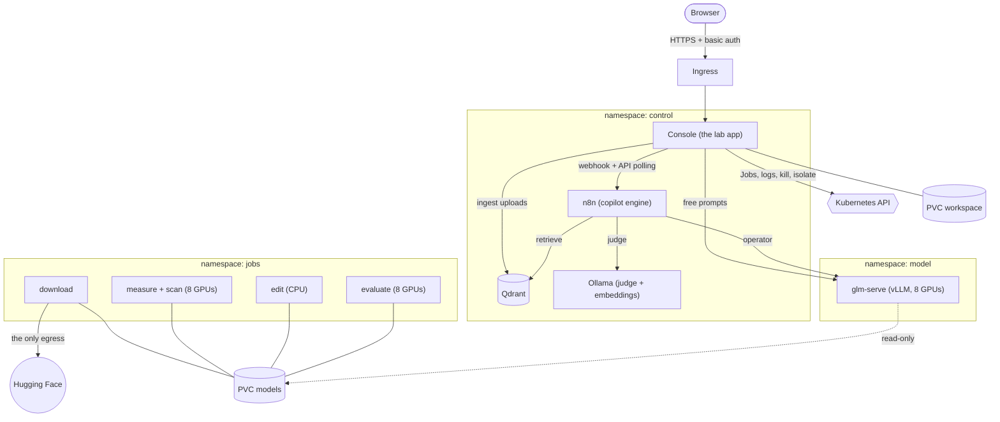
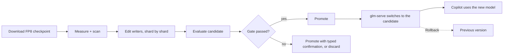
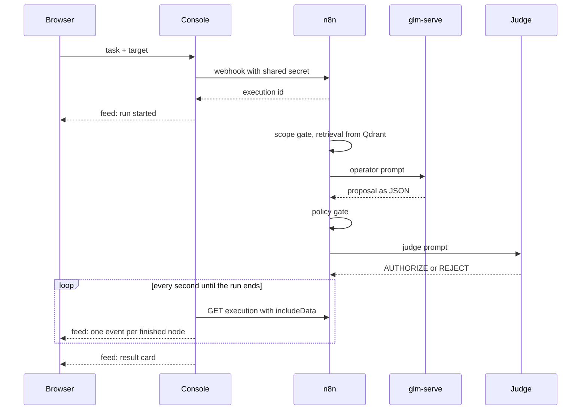
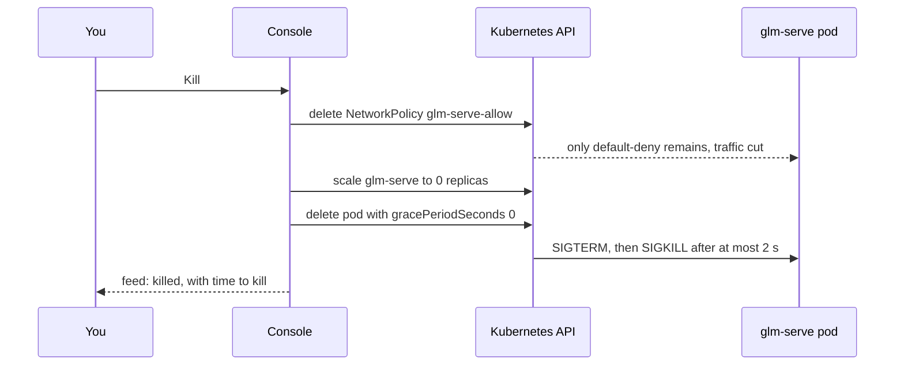

# Design: GLM-5.3 on Kubernetes, from abliteration to the copilot

Status: **proposal**, nothing below is built yet. Section 10 is the build order.

## 1. What this adds

A run goes **download → measure → edit → evaluate → promote**. Promote makes the abliterated GLM-5.3 the operator model
of the pentest copilot (`deploy/n8n/`). One web console drives all of it:

- **Abliterate:** each stage runs as a Kubernetes Job with its log live in the console. After reading the eval report you
  promote or roll back with one click.
- **Copilot:** prompts and tasks go in, and every stage arrives in a live feed: scope gate, retrieval, operator, policy
  gate, judge, result.
- **Knowledge:** upload writeups and notes into the retrieval store, list them, delete them.
- **Kill / Isolate:** stop the container running the abliterated model, or cut its network while it keeps running.

### Decisions taken

| Question | Decision | Consequence |
| --- | --- | --- |
| Where GLM-5.3 runs | On-prem **and** cloud | One Kustomize base with `onprem` and `cloud` overlays |
| Copilot engine | **n8n** stays | The console starts n8n runs and polls their progress: a stage-level feed, no token streaming for copilot runs |
| Login | **Basic auth**, one shared account | The audit log records sessions and source IPs, not people |
| Kill switch | **Kill** and **Isolate** buttons | No automatic kill, no tripwires |

### Out of scope

- **Running commands.** The stack suggests and decides; it never executes. The n8n *Execute* node stays disabled and
  `LAB_RUNNER_URL` stays yours. You run approved commands yourself.
- **Fine-tuning GLM-5.3.** The QLoRA tooling in `copilot/` is meant for small operator models.
- **Per-user identity and multi-tenancy.**

## 2. Sizing

From `README.md` §6 and the model catalogue in `app/server.py`:
- **Shape:** `GlmMoeDsaForCausalLM`, 744B parameters, 78 layers: 3 dense, then 75 mixture-of-experts layers with 256 routed
  experts plus 1 shared, 8 active.
- **Size:** 1.5 TB in bf16 (282 shards).
- **The edit:** touches about 19,400 tensors and streams one shard at a time (about 5 GB of RAM).

| Stage | Needs | Runs on | Notes |
| --- | --- | --- | --- |
| Download | ~750 GB of disk, internet access to Hugging Face | any node | The FP8 checkpoint. The edit keeps the FP8 block scaling, so the result can be served as is. |
| Measure + scan | the whole model in GPU memory on **one** node | 8×H200 (1.1 TB) or 8×B200 | `device_map=auto` shards across the GPUs of one machine only |
| Edit | ~5 GB of RAM, fast storage | a CPU node that mounts the model volume | Hours; storage speed is the limit |
| Evaluate | vLLM, tensor parallel 8 | the GPU node | Base and candidate one after the other, not side by side |
| Serve | vLLM, tensor parallel 8 | the GPU node | The copilot's operator |
| Judge + embeddings | ~8 GB | a small GPU or CPU | qwen3:8b with thinking off, nomic-embed-text, both in Ollama |

- **Storage:** 3–4 TB of fast storage. Base FP8 (0.75 TB), the promoted version, the previous one for rollback, and the
  candidate under evaluation.
- **One GPU node means one thing at a time.** Measuring and evaluating need the node the model is served from, so the
  console refuses to start those Jobs while the model runs ("GPU node busy"). With two GPU nodes, serving and evaluating run
  in parallel.
- **Risk:** the GLM-5.x code path has only been tested on synthetic tensor layouts (README §4). The first real run is also
  its first real test. That is why phase 0 validates the whole stack on a smaller model first.

## 3. Architecture



- **`control`:** the console, n8n, Qdrant, and Ollama for the judge and the embeddings. The Ingress with basic auth points
  here.
- **`model`:** only vLLM serving the promoted abliterated model. Nothing else lives here, because the kill switch's
  permissions cover the whole namespace.
- **`jobs`:** the download, measure, edit and evaluate Jobs.
- **Storage:**
  - PVC `models`: base, candidates, promoted, previous;
  - PVC `workspace`: runs, datasets, uploads, audit log.

| Component | Kind | Reachable from |
| --- | --- | --- |
| console (the lab app, extended) | Deployment, 1 replica | Ingress (basic auth, TLS) |
| n8n | Deployment, 1 replica | the console; the editor through `kubectl port-forward` |
| Qdrant | StatefulSet | n8n, the console |
| Ollama (judge, embeddings) | Deployment | n8n, the console |
| glm-serve (vLLM) | Deployment, 0 or 1 replicas | n8n and the console only |
| download / measure / edit / evaluate | one Job per stage | nothing |

### On-prem and cloud overlays

| | `onprem` (e.g. RKE2) | `cloud` (AKS, EKS, GKE or a GPU cloud) |
| --- | --- | --- |
| GPUs | NVIDIA GPU Operator, fixed GPU node | GPU node pool that scales from 0, tainted for model workloads |
| `models` volume | local NVMe on the GPU node (pins model workloads to it) or RWX (Longhorn, CephFS, NFS) | RWX file storage (Azure Files NFS, EFS, Filestore), or a block disk plus node affinity |
| Network policies | RKE2's default Canal enforces them | AKS: Azure NPM or Cilium. EKS: network policies enabled in the VPC CNI. GKE: Dataplane V2. |
| Ingress | ingress-nginx | the provider's ingress-nginx or equivalent |
| Cost | none per hour | Kill scales the model to 0, so the autoscaler can remove the idle GPU node: Kill also stops the bill |

## 4. Abliterate → evaluate → promote



- **Run folder:** every run is `models/runs/<run-id>/` with a `manifest.json` holding:
  - the base repo and revision;
  - the chosen layers and direction;
  - the pipeline's git commit;
  - the eval metrics and the state.
- **Evaluation:**
  - **Refusals:** refusal rate on held-out harmful prompts, base vs candidate.
  - **Harmless capability:** agreement with the base model on harmless prompts, plus a small fixed benchmark subset.
  - **Copilot fitness:** `copilot.eval_operator` against the candidate's endpoint (`json_ok`, `target_ok`, `placeholder`,
    `policy_allowed`). This needs an OpenAI-compatible client in `eval_operator`, which today only talks to Ollama.
  - **Gate:** configurable thresholds give pass or fail. **Promote** stays disabled until the report exists, and a failed
    gate needs a typed confirmation.
- **Promote:** points the `glm-serve` ConfigMap at the run's checkpoint and restarts the Deployment. The copilot uses the
  new model from the next request. The previous version stays on disk, and **Rollback** is the same step in reverse.
- **Operator node:** today the n8n operator node talks to Ollama. `build_workflow.js --operator openai` will generate n8n's
  OpenAI Chat Model node instead, with the credential's *Base URL* set to `http://glm-serve.model.svc:8000/v1` (n8n 2.48's
  OpenAI credential has that field). GLM-5.x reasons before it answers, so vLLM runs with its GLM reasoning parser and n8n
  receives only the answer.

## 5. Copilot runs (n8n engine)



- **Start:** the console starts a run through a new webhook trigger. It sends a shared-secret header, n8n answers at once
  with the execution id, and then the existing pipeline runs. The form trigger stays as a second way in.
- **Progress:** the console reads it from n8n's public API, `GET /api/v1/executions/{id}?includeData=true`, every second,
  authenticated with the `X-N8N-API-KEY` header. You create that key once in n8n (Settings → n8n API); the console reads it
  from a Secret.
- **Events:** each finished node becomes one feed event:
  - scope verdict;
  - retrieval status and reference count;
  - the operator's proposal;
  - the policy decision with reasons;
  - the judge's verdict;
  - the result.

  Model text is escaped exactly as on the form's result page.
- **Stop run:** `POST /api/v1/executions/{id}/stop`.
- **Free prompts** are model testing, not copilot runs. The console sends them straight to vLLM and streams the answer token
  by token, as the Compare stage does today with Ollama, and logs them in the feed. They skip the policy gate and the judge,
  since nothing can execute either way.

## 6. Knowledge uploads (retrieval)

- **Upload:** md, txt, html and pdf, up to 50 MB per file, with a source type: `htb`, `blog`, `engagement` or `pwk`. Files
  are stored under `workspace/writeups/<source>/`.
- **Preview:** for `engagement` notes the console shows the scrubber's redactions (`copilot.ingest --dry-run
  --show-redactions`) before anything is embedded.
- **Ingest:**
  1. scrub;
  2. chunk;
  3. embed;
  4. upsert into Qdrant with deterministic ids, so uploading a file again replaces its chunks.
- **List / delete:** documents with their chunk counts. Delete removes the file and its vectors (filter on `metadata.doc`).
- **PDF:** text extraction with `pypdf` is new. Scanned PDFs need OCR first, which is out of scope.
- **Ingress:** the request-size limit rises to 50 MB, for the upload path only.
- **Trust:** uploaded text stays untrusted. It reaches only the operator, with addresses masked, never the judge, and the
  policy gate stays the boundary.

## 7. Live feed

- **One stream, one schema:** `{ts, source, run_id, stage, level, message, data}`. It reaches the browser as Server-Sent
  Events; the app already streams pipeline logs this way.
- **Sources:**
  - **Jobs:** Job status and the pod log, read from the Kubernetes API with `follow`.
  - **Copilot:** n8n node events (section 5).
  - **Model:** Deployment status and readiness, plus vLLM's `/metrics` (running requests, tokens per second) every 5 s.
  - **Kill / Isolate:** the request, each API answer, and the time until the pod is gone.
  - **Uploads:** ingest progress.
- **Audit:** every event is also appended to `workspace/audit/YYYY-MM-DD.jsonl` with the session's source IP. With one
  shared login, that is the only "who".

## 8. Kill and Isolate

Kubernetes network policies only ever **allow**. A "deny everything" policy added next to an existing allow policy changes
nothing, because traffic is allowed as soon as any policy allows it. So isolation works by **removing the allow**:

- **Always in `model`:** `default-deny`, which selects every pod and allows nothing in or out.
- **The one opening:** `glm-serve-allow`, which allows traffic in on port 8000 from n8n and the console. Nothing is allowed
  out, so vLLM runs with `HF_HUB_OFFLINE=1`.



**Isolate**
- **What it does:** deletes `glm-serve-allow`. The model keeps running, GPU memory included, so you can inspect it, but
  nothing reaches it and it reaches nothing.
- **Release:** recreates the policy from the console's copy of it.
- **Caveat:** network plugins differ on connections that are already open when the policy goes. The e2e test checks it on
  your plugin, and Kill is the hard stop.

**Kill**
1. Isolate first: the instant cut.
2. Scale `glm-serve` to 0, so Kubernetes does not bring the pod back.
3. Delete the pod with `gracePeriodSeconds: 0`. The kubelet's minimum grace period still applies: SIGTERM, then SIGKILL
   after at most about 2 s.

After a kill:
- **Start:** an explicit button scales the model back to 1 and recreates the allow policy. GLM-5.3 takes minutes to load.

**Permissions** for the console's ServiceAccount, in `model` only:

| Resource | Verbs | Limited to |
| --- | --- | --- |
| `deployments/scale` | get, patch | `glm-serve` |
| `deployments` | get, watch | `glm-serve` |
| `pods` | get, list, watch, delete | the namespace; pods can't be limited by name, so `model` holds nothing else |
| `networkpolicies` | get, delete | `glm-serve-allow` |
| `networkpolicies` | create | the namespace; Kubernetes can't limit create by name |

No `pods/exec`, nothing cluster-wide. The kill path depends only on the API server, never on the model pod.

**Fallback** when the console itself is down:

```bash
kubectl -n model delete networkpolicy glm-serve-allow
kubectl -n model scale deploy/glm-serve --replicas=0
kubectl -n model delete pod -l app=glm-serve --grace-period=0 --force
```

## 9. Security

- **Model pod:**
  - no outbound traffic; inbound only from n8n and the console;
  - weights mounted read-only;
  - no service-account token, runs as non-root, read-only root filesystem.
- **Jobs:** only the download Job reaches the internet, and only Hugging Face. Plain network policies can't filter by host
  name, so this needs an egress proxy or the network plugin's FQDN policies (Cilium, Calico Enterprise). Measure, edit and
  evaluate have no egress.
- **Weights never leave the cluster.** A read-only Hugging Face token lives only in the download Job, and no pod can push
  anywhere.
- **Console:** basic auth and TLS on the Ingress; an IP allowlist annotation is recommended. The n8n editor stays off the
  Ingress (port-forward).
- **Secrets:** all as Kubernetes Secrets (Sealed Secrets or External Secrets optional):
  - the htpasswd file;
  - the n8n encryption key and API key;
  - the webhook secret;
  - the Hugging Face token.
- **Images:** vLLM, n8n, Qdrant and Ollama pinned by digest.

## 10. Build order

| Phase | Delivers | Verified by |
| --- | --- | --- |
| 0 | `dev` overlay: the whole stack with a small model (GLM-Edge on CPU, or GLM-4.5-Air on 4×H100) | kind with Calico in CI, then your cluster |
| 1 | Kustomize base, `onprem` and `cloud` overlays. They contain:<br>namespaces, PVCs, RBAC, network policies, Ingress;<br>n8n, Qdrant, Ollama;<br>glm-serve at 0 replicas | `kubectl apply --dry-run=server`, kind |
| 2 | Abliteration stages as Jobs with live logs, run registry, Promote and Rollback | kind with GLM-Edge on CPU |
| 3 | n8n webhook trigger, OpenAI-compatible operator node, console polling into the live feed, free prompts to vLLM | real n8n, vLLM stand-in |
| 4 | Kill and Isolate with RBAC and audit | kind with Calico: time to kill, isolation cuts traffic |
| 5 | Knowledge uploads incl. PDF, list and delete | unit tests, live ingest |
| 6 | GLM-5.3: download, measure, edit, evaluate, promote | your 8×H200 node, on-prem or cloud |

## 11. Open questions

1. Which vLLM (or SGLang) version serves GLM-5.3 with its sparse attention and FP8 on your GPUs? Pin it after a smoke test.
2. One GPU node (serving and jobs take turns) or two (serve while evaluating)?
3. Which provider for the `cloud` overlay? It decides the storage class and the network-policy plugin.
4. Gate thresholds. Start with:
   - refusal rate ≤ 5 %;
   - harmless agreement ≥ 90 %;
   - `json_ok` ≥ 0.9.

   Tune after the first runs.
